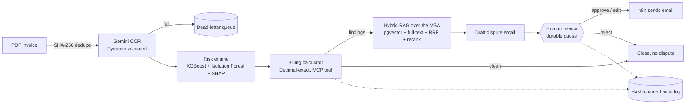

# Project Title

A brief description of what this project does and who it's for

<div align="center">

```
┌──────────────────────────────────────────────────────────────┐
│  APEX FREIGHT                              INVOICE INV-000081 │
│  ──────────────────────────────────────────────────────────  │
│  Linehaul ............................................ $1,250 │
│  Fuel surcharge (contract: 10%) ......................  $190 ◄ 52% over
│  Detention (5.0 hrs, 3.0 billable) ...................  $300 ◄ $120 over
│  ──────────────────────────────────────────────────────────  │
│  TOTAL DUE ........................................... $1,740 │
│                                                              │
│  FREIGHTGUARD:  ✗ HOLD   $185.00 recoverable                 │
│                 cites MSA 5.1 and 6.2 · awaiting human sign-off
└──────────────────────────────────────────────────────────────┘
```

# FreightGuard AI

**Carriers bill. FreightGuard checks the contract, does the arithmetic, and asks a human before it complains.**


</div>

---

## The problem in one paragraph

Freight invoices go wrong in boring, repeatable ways: the same PRO number billed twice, a fuel surcharge nobody approved, detention charged for hours that were free, a rate that quietly drifted from the rate card. Each error is small. Across thousands of invoices they add up, and nobody has time to read every MSA clause. This project finds those errors, proves them with exact arithmetic, quotes the contract, and drafts the dispute, but never sends it without a person pressing a button.

## How an invoice travels



## Why it is built this way

| Decision | Reason |
|---|---|
| Money math is plain Python with `Decimal`, never the LLM | A dispute with a wrong dollar figure is worse than no dispute. |
| The model proposes, the calculator proves | ML ranks what to look at; only deterministic checks produce overcharge amounts. |
| Hybrid retrieval, not vectors alone | "Section 5.1" and "FSC-01" are exact strings. Full-text search catches them; embeddings catch paraphrases; rank fusion keeps both. |
| `interrupt()` before every email | The workflow state is checkpointed, so a reviewer can answer tomorrow, after a restart. |
| Every score, decision and approval goes in a hash chain | Editing any past entry breaks every hash after it, and a test proves it. |

## Run it

<details open>
<summary><b>Without Docker</b> (about two minutes)</summary>

```bash
python -m venv .venv && source .venv/bin/activate
pip install pandas openpyxl numpy scikit-learn xgboost imbalanced-learn shap fastapi uvicorn \
  httpx pydantic reportlab pytest pyyaml pypdf joblib langgraph langgraph-checkpoint-postgres \
  "psycopg[binary]" pgvector flashrank google-genai "mcp<2"

python data/generator/generate.py     # seed invoices, PDFs, rate cards, contracts
python evals/run_all_evals.py         # scorecard -> evals/reports/scorecard.md
pytest -q tests

(cd services/node-api && npm i && npm test)
(cd apps/ops-portal  && npm i && npm test && npm run dev)   # http://localhost:5173
```
</details>

<details>
<summary><b>Full stack with Docker</b></summary>

```bash
python data/generator/generate.py     # images copy data/seed, so run this first
export GEMINI_API_KEY=...             # optional: without it, OCR and embeddings use offline fallbacks
docker compose up --build
```

| Service | Port |
|---|---|
| Ops portal | 5173 |
| Node BFF | 4000 |
| Risk engine | 8001 |
| Dispute agent | 8002 |
| OCR/ETL | 8003 |
| n8n (import `workflows/n8n/*.json`) | 5678 |
| Postgres + pgvector | 5432 |
</details>

## What the tests and evals actually measured

Everything below ran on **synthetic** data: 1,800 invoices, about 4% overbilled, five error types. Treat these as evidence that the pipeline works, not as real-world accuracy.

| Check | Result |
|---|---|
| Agent flags overbilled invoices | precision **0.984**, recall **0.849** (673 invoices) |
| Overcharge total within $15 of truth | 100% of flagged overbilled cases |
| Dispute cites the correct MSA clause | 100% |
| XGBoost vs logistic regression (PR-AUC) | 0.716 vs 0.705, a small gap on about 20 test positives |
| OCR, regex baseline | 90.9% of documents exactly right, field F1 0.93 |
| Audit chain after a full eval run | valid |

Three honest caveats:
- The OCR number comes from a regex baseline over generated PDFs. Gemini is used only when `GEMINI_API_KEY` is set.
- The reranker fell back to a lexical scorer in the build environment because the FlashRank model could not download. The eval report records which backend ran.
- Cost per 1,000 disputes (about $0.05) is an estimate, because drafts come from a template unless an LLM is passed in.

## Not verified yet

Written but never executed against real infrastructure: `docker compose up`, the Postgres checkpointer, the pgvector and full-text SQL, the Power BI materialized views, live Gemini calls.

## Known gaps

- The agent imports the billing module directly. The MCP server exposes the same tools, but the graph does not call it through an MCP client yet.
- No Langfuse or OpenTelemetry exporter. OCR returns latency and token counts per call, and prompts are versioned in `prompts/v1/`.
- The Power BI folder is a specification (views, DAX, relationships), not a `.pbix` file.

## Map of the repo

```
services/
  mcp-tools/       billing math, audit chain, MCP server
  ml-risk-engine/  features, training, scoring API with SHAP
  etl-ocr/         Gemini extraction, hash dedupe, dead-letter queue
  dispute-agent/   LangGraph flow, hybrid RAG, human review API
  node-api/        Express BFF (Mongo raw payloads, Postgres ledger, n8n hook)
apps/ops-portal/   reviewer cockpit: findings, SHAP bars, clause quotes, approve/edit/reject
workflows/n8n/     inbound watch, approval to carrier email
bi/powerbi/        views.sql, measures.dax, setup guide
evals/             OCR, ML and agent evals, one scorecard
prompts/v1/        versioned prompts
data/generator/    synthetic invoices, rate cards, contracts
```

## License

Choose one before publishing, for example MIT.
